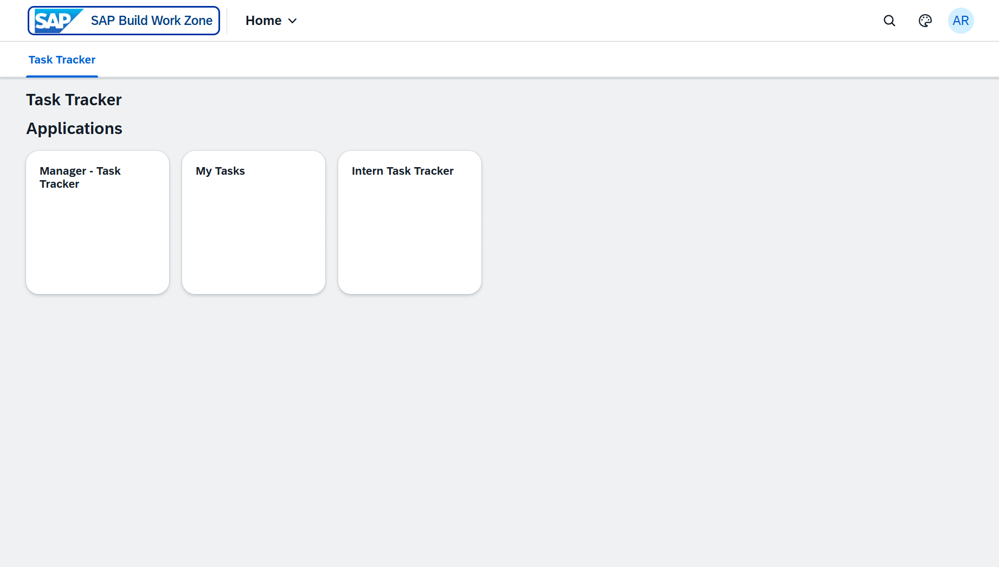
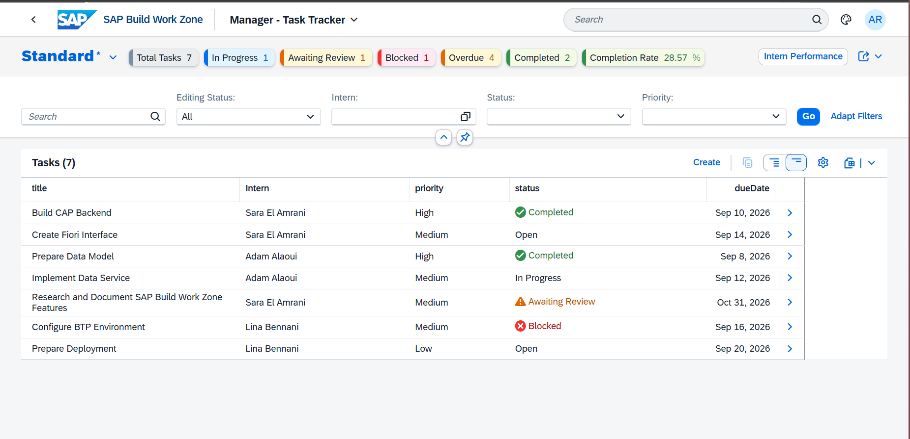
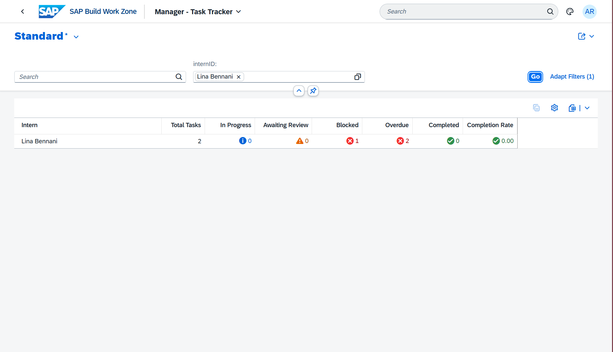
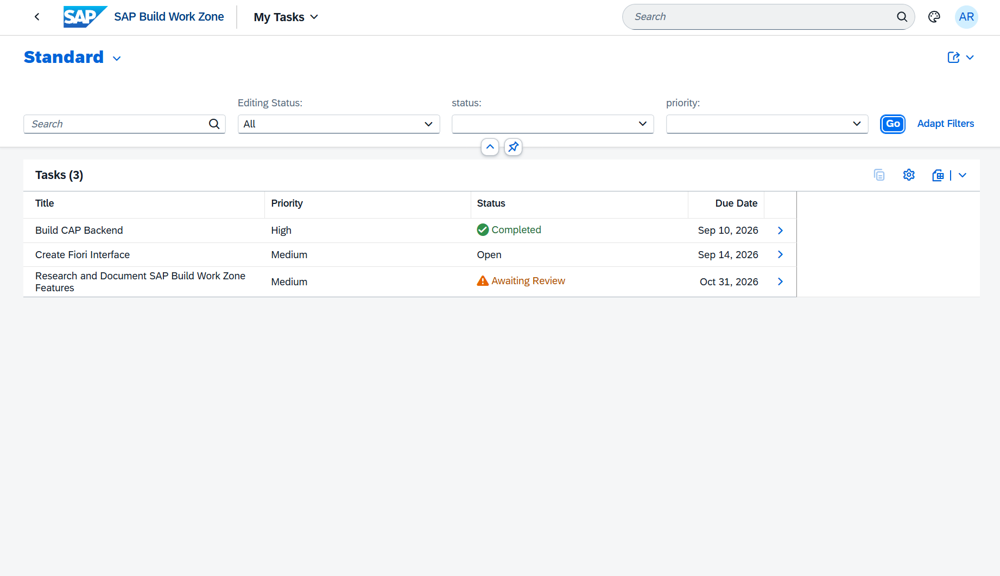
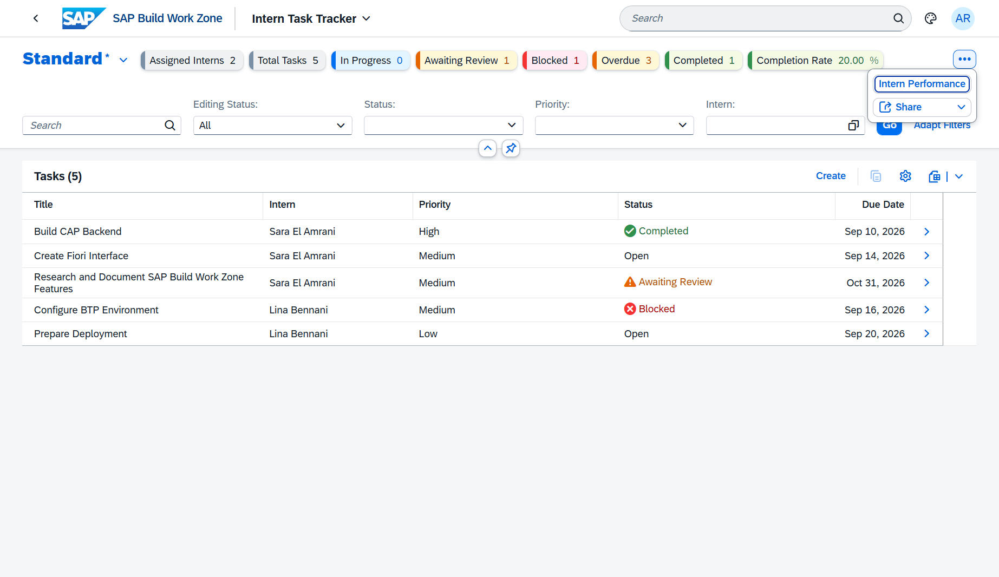
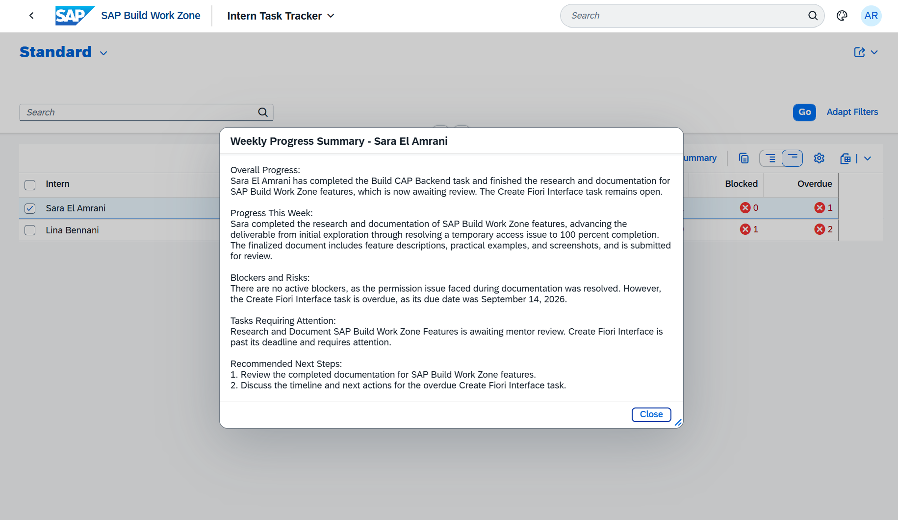

# SAP Intern Task Tracker

A role-based internship task management application built with **SAP CAP**, **SAP Fiori Elements**, **SAP HANA Cloud**, **XSUAA**, and **SAP Build Work Zone**.

The application supports the complete internship task lifecycle, from task assignment and progress tracking to mentor review, performance monitoring, audit logging, and AI-generated weekly summaries.

This project was developed as a **Final-Year Academic Project (PFA)**.

---

## Overview

The application provides dedicated experiences for three roles:

### Intern

Interns can:

- view their assigned tasks;
- update task progress;
- add progress comments;
- block and resume tasks;
- submit tasks for review;
- view mentor feedback.

### Mentor

Mentors can:

- monitor the interns assigned to them;
- review submitted tasks;
- complete tasks after validation;
- provide feedback;
- access intern performance KPIs;
- generate AI-powered weekly progress summaries.

### Manager

Managers can:

- monitor all interns and tasks;
- access global KPIs;
- analyze performance by intern;
- review audit logs for important business actions.

---

## Main Features

- Role-based access for **Intern**, **Mentor**, and **Manager**
- Task lifecycle management
- Progress tracking and mentor feedback
- KPI dashboards
- Per-intern performance monitoring
- Audit logging of important business actions
- AI-generated weekly progress summaries with Google Gemini
- SAP BTP deployment
- Automated backend tests
- Continuous Integration with GitHub Actions

---

## Task Lifecycle

The backend enforces the task workflow and prevents invalid state transitions.

Typical lifecycle:

```text
OPEN
  ↓
IN_PROGRESS
  ↓
AWAITING_REVIEW
  ↓
COMPLETED
```

Tasks can also be blocked and resumed when necessary.

Business rules are implemented in the CAP service layer to ensure that actions are executed only by authorized users and only when the task is in a valid state.

---

## KPI Dashboards

Mentor and Manager applications provide KPIs such as:

- Total Tasks
- Open Tasks
- In Progress Tasks
- Awaiting Review Tasks
- Completed Tasks
- Blocked Tasks
- Overdue Tasks
- Completion Rate

The application also provides performance indicators for individual interns.

---

## AI Weekly Progress Summary

The Mentor application integrates the **Google Gemini API** to generate a weekly progress summary for a selected intern.

The summary considers task information and can highlight:

- overall progress;
- recent activity;
- blockers and risks;
- tasks requiring attention;
- recommended next steps.

The AI integration is isolated in:

```text
srv/gemini-client.js
```

The API key is provided through the environment variable:

```text
GEMINI_API_KEY
```

No API key is stored in the source code.

---

## Security

Production authentication and authorization are handled with **SAP XSUAA**.

The application defines three roles:

```text
Intern
Mentor
Manager
```

Role collections on SAP BTP control access to the corresponding applications and services.

The CAP backend also applies business-level authorization rules to restrict access to the appropriate data and actions.

For local development, CAP mocked authentication is used.

---

## Audit Logging

Important business actions are stored in audit logs, including:

- blocking a task;
- resuming a task;
- submitting a task for review;
- completing a task.

This provides traceability of important operations performed by application users.

---

## Architecture

```text
SAP Build Work Zone
        ↓
Managed AppRouter
        ↓
HTML5 Application Repository
        ↓
SAP Fiori Elements Applications
        ↓
Destination Service
        ↓
SAP CAP Backend
        ↓
SAP HANA Cloud
```

Authentication and authorization are handled through **XSUAA**.

The application uses the managed routing provided by the SAP BTP HTML5 / Work Zone architecture rather than a standalone AppRouter.

---

## Applications

The project contains three SAP Fiori Elements applications:

```text
app/
├── mytasks/     Intern application
├── tasks/       Mentor application
└── manager/     Manager application
```

Custom SAPUI5 controller extensions and fragments are used where additional behavior is required beyond standard Fiori Elements capabilities.

---

## Technology Stack

| Area                | Technologies                                |
| ------------------- | ------------------------------------------- |
| Backend             | SAP CAP, Node.js, JavaScript, CDS, OData V4 |
| Frontend            | SAP Fiori Elements, SAPUI5, CDS Annotations |
| Database            | SAP HANA Cloud, HDI Container, SQLite       |
| Security            | SAP XSUAA, Roles, Role Collections          |
| Platform            | SAP BTP Cloud Foundry, SAP Build Work Zone  |
| Application Hosting | HTML5 Application Repository                |
| AI                  | Google Gemini API                           |
| Testing             | `@cap-js/cds-test`                          |
| CI                  | GitHub Actions                              |

---

## Automated Testing

The project contains **26 automated tests across 8 test suites**.

The tests cover:

- authorization;
- task validation;
- task lifecycle;
- progress updates;
- mentor feedback;
- KPI calculations;
- audit logging;
- AI summary generation.

Run the test suite with:

```bash
npm test
```

The Gemini integration is mocked during automated tests, so the test suite does not depend on external API calls.

---

## Continuous Integration

GitHub Actions automatically validates the project on pushes and pull requests.

The CI workflow performs:

```text
Checkout repository
        ↓
Setup Node.js 24
        ↓
npm ci
        ↓
npm test
```

The workflow is defined in:

```text
.github/workflows/ci.yml
```

---

## Project Structure

```text
intern-task-tracker/
├── app/
│   ├── manager/
│   ├── mytasks/
│   └── tasks/
├── db/
├── srv/
├── test/
├── scripts/
├── .github/
│   └── workflows/
│       └── ci.yml
├── mta.yaml
├── xs-security.json
├── package.json
└── README.md
```

---

## Local Development

### Requirements

- Node.js 24
- npm
- SAP CDS development tools

Install dependencies:

```bash
npm ci
```

Start the CAP application:

```bash
cds watch
```

The individual Fiori applications can also be started with:

```bash
npm run watch-mytasks
npm run watch-tasks
npm run watch-manager
```

The project uses:

```text
Development → SQLite
Testing     → SQLite in-memory
Production  → SAP HANA Cloud
```

---

## SAP BTP Deployment

The project is packaged as an SAP Multi-Target Application using:

```text
mta.yaml
```

Build the deployment archive with:

```bash
npx mbt build
```

The production environment uses:

- SAP HANA Cloud
- XSUAA
- Destination Service
- HTML5 Application Repository
- SAP Build Work Zone
- SAP Cloud Foundry

---

## Application Preview

### SAP Build Work Zone

The applications are exposed through SAP Build Work Zone, with dedicated access for Intern, Mentor, and Manager roles.



### Manager Dashboard

The Manager application provides a global view of tasks, statuses, overdue work, completion rate, and intern performance.



### Intern Performance

Managers can analyze KPIs for an individual intern.



### Intern Application

Interns see only their assigned tasks and can follow their status throughout the task lifecycle.



### Mentor Dashboard

Mentors monitor the interns assigned to them, review tasks, and track workload and completion KPIs.



### AI-Powered Weekly Summary

Mentors can generate a weekly progress summary using Google Gemini based on the selected intern's tasks and progress information.



---

## Project Context

This project was developed as a **Final-Year Academic Project (PFA)** to design and implement a role-based internship management solution using the SAP BTP ecosystem.

The project focuses on enterprise application development concepts including business workflows, authorization, cloud persistence, Fiori user interfaces, automated testing, continuous integration, auditability, and AI-assisted functionality.
